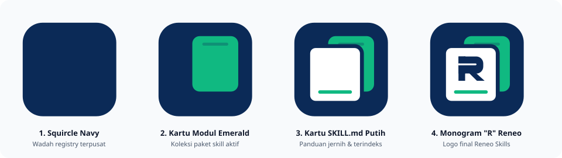

# Filosofi & Pembentukan Logo Reneo Skills

> **Reneo Skills**: Katalog dan pusat distribusi skill agent terstruktur dalam ekosistem **Reneo**.

Dokumen ini mencatat filosofi, tahapan pembentukan bentuk, dan spesifikasi teknis logo **Reneo Skills** agar tetap konsisten di seluruh permukaan aplikasi (header galeri, panel admin, favicon, dan App Store Reneo Panel).

---

## 1. DNA Visual Ekosistem Reneo

Logo **Reneo Skills** menurunkan standar visual yang sama dengan **Reneo CRM** dan **Reneo SIDesa**:

| Elemen | Nilai | Peran & Makna |
| :--- | :--- | :--- |
| **Kanvas** | `viewBox="0 0 512 512"` | Grid persegi presisi agar tajam dari ukuran `16px` hingga cetak |
| **Wadah Squircle** | `x=40 y=40 w=432 h=432 rx=92` | Bingkai aplikasi resmi ekosistem Reneo |
| **Reneo Navy** | `#0B2A57` | Ketenangan kendali, keteraturan katalog, dan identitas utama Reneo |
| **Reneo Emerald** | `#10B981` | Skill siap pakai, modul aktif, dan distribusi cepat ke agent |
| **Putih Bersih** | `#FFFFFF` | Kejernihan dokumentasi `SKILL.md` dan keterbacaan instruksi |

---

## 2. Tahap Pembentukan Logo (4 Lapisan)

Logo **Reneo Skills** disusun dari 4 lapisan geometris:

### Tahap 1: Wadah Squircle Navy (`#0B2A57`)
- **Bentuk**: Persegi sudut membulat `432 x 432` (`rx="92"`).
- **Makna**: Satu registry terpusat tempat seluruh paket skill, skrip, dan dokumentasi disimpan rapi.

### Tahap 2: Kartu Modul Belakang Emerald (`#10B981`)
- **Bentuk**: Kartu vertikal di kanan atas (`x: 196..408, y: 102..358, rx="34"`) dengan bilah indeks tipis di bagian atas.
- **Makna**: Melambangkan koleksi banyak modul skill yang tersusun dalam galeri dan siap dipakai lintas agent.

### Tahap 3: Kartu Utama `SKILL.md` Putih (`#FFFFFF`)
- **Bentuk**: Kartu dokumen utama di kiri depan (`x: 104..352, y: 148..410, rx="34"`) dengan garis pemisah `stroke="#0B2A57" stroke-width="18"` serta bilah indeks emerald (`y="352"`) di bagian bawah.
- **Makna**: Melambangkan dokumen instruksi `SKILL.md` yang bersih, terstruktur, dan terpisah tegas dari lapisan di belakangnya agar tetap terbaca pada ukuran ikon kecil.

### Tahap 4: Monogram "R" Reneo di Tengah Kartu Utama
- **Bentuk**: Monogram **"R"** geometris berwarna **Reneo Navy (`#0B2A57`)**, diposisikan dengan `translate(94.8, 118.0) scale(0.52)`.
- **Makna**: Menyatukan standar kualitas ekosistem Reneo ke dalam setiap skill yang didistribusikan.

---

## 3. Anatomi Geometri Monogram "R"

Monogram **"R"** dibangun dari primitif SVG murni (tanpa ketergantungan font):
- **Mangkuk Kanan**: `rect x="146" y="150" width="220" height="152" rx="62"`
- **Batang Vertikal Kiri**: `rect x="146" y="150" width="60" height="216"`
- **Kaki Diagonal**: `polygon points="238,296 300,296 378,366 310,366"`
- **Ruang Negatif (Potongan Putih)**: Bilah horizontal `height="16" rx="8"` pada `y="212"` dan potongan bawah `polygon points="206,302 244,302 300,366 206,366"`.

---

## 4. Sumber Aset & Aturan Penggunaan

- **Logo Frontend & Favicon**: `frontend/public/logo.svg` dan `frontend/public/favicon.svg`
- **Ikon App Store Reneo Panel**: `public/icons/apps/reneo-skills.svg` (di repositori `homeserver-desktop`)

### Pedoman Praktis
1. **Konsistensi warna**: Pertahankan `#0B2A57`, `#10B981`, dan `#FFFFFF` tanpa menggantinya dengan gradient dekoratif.
2. **Kontras latar**: Wadah squircle navy solid membuat logo aman dipakai langsung di latar terang maupun latar gelap.
3. **Skala minimum**: Hindari menampilkan logo di bawah `16px`.
